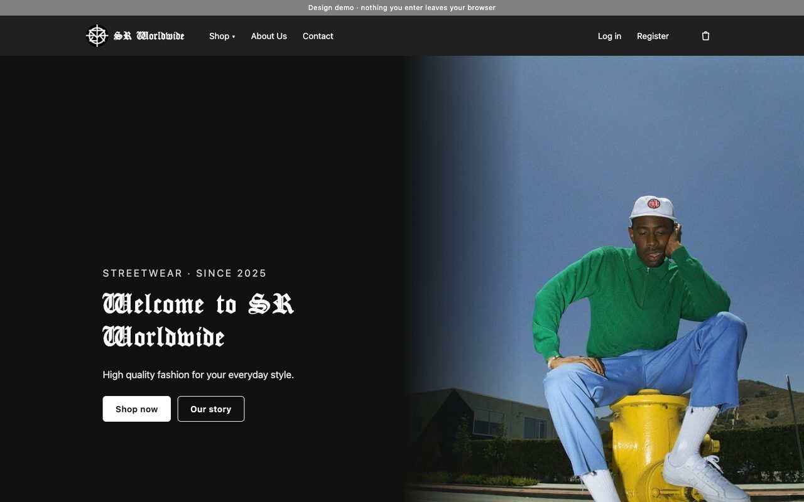
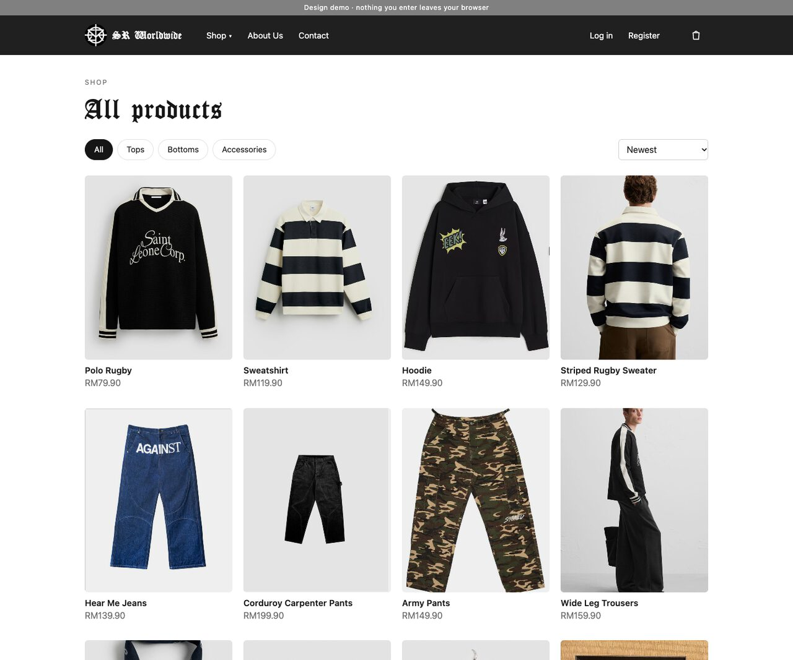
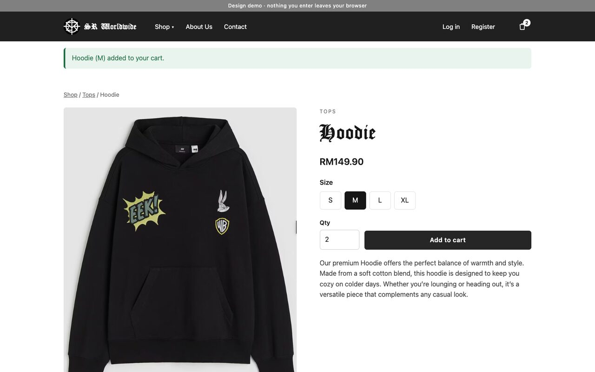
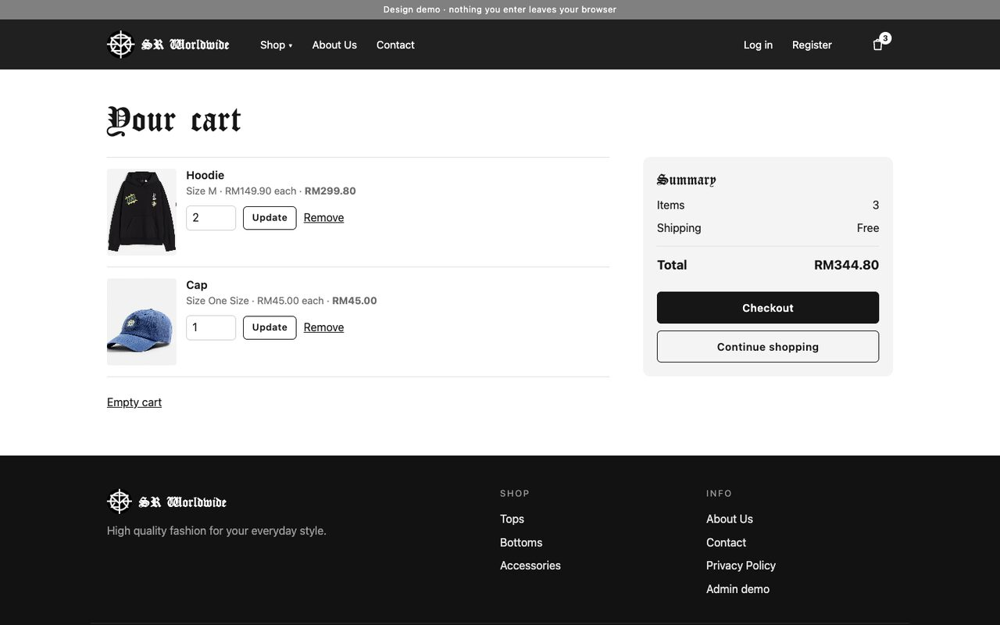
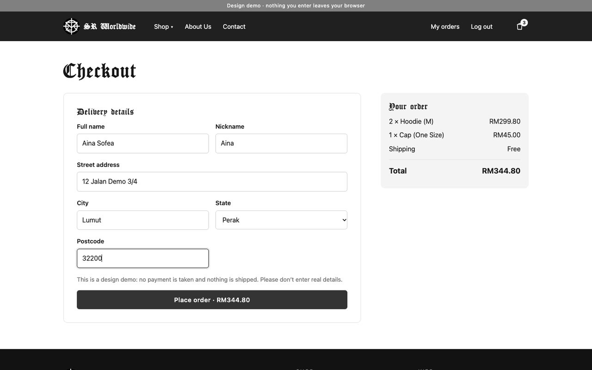
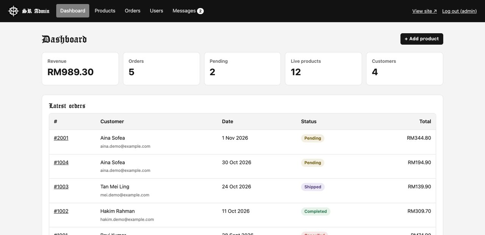
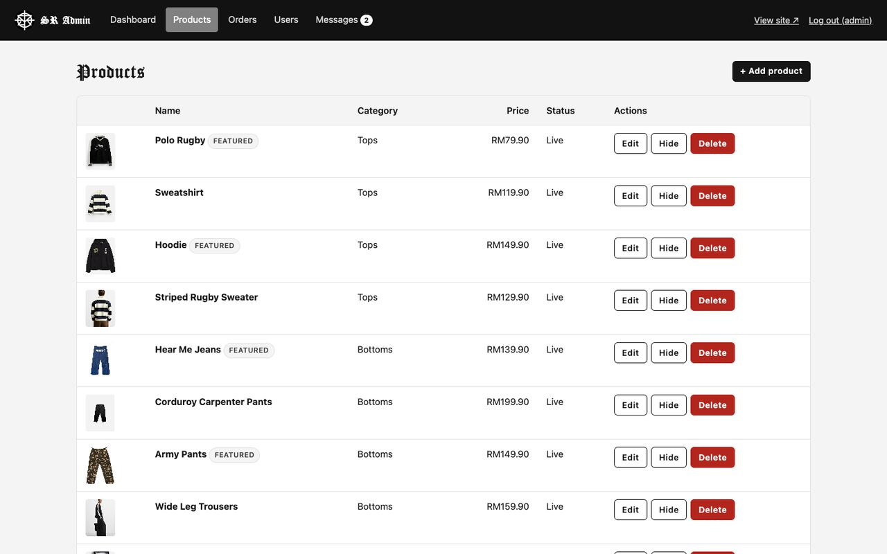
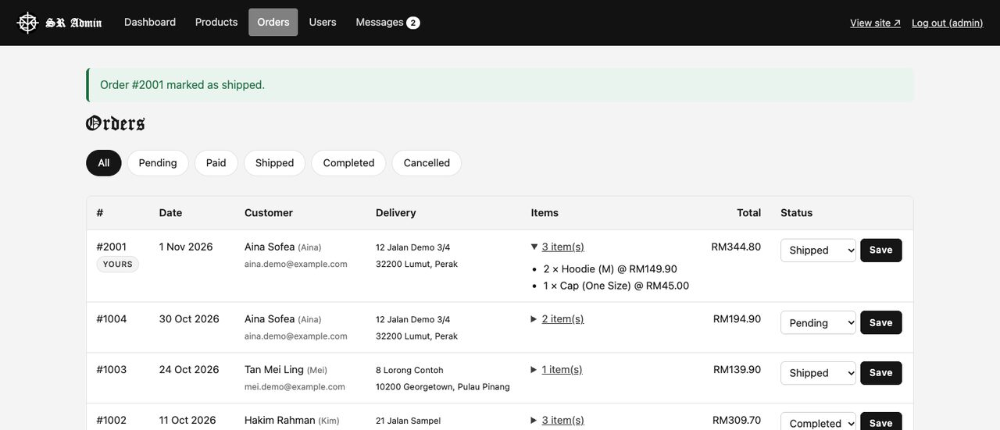
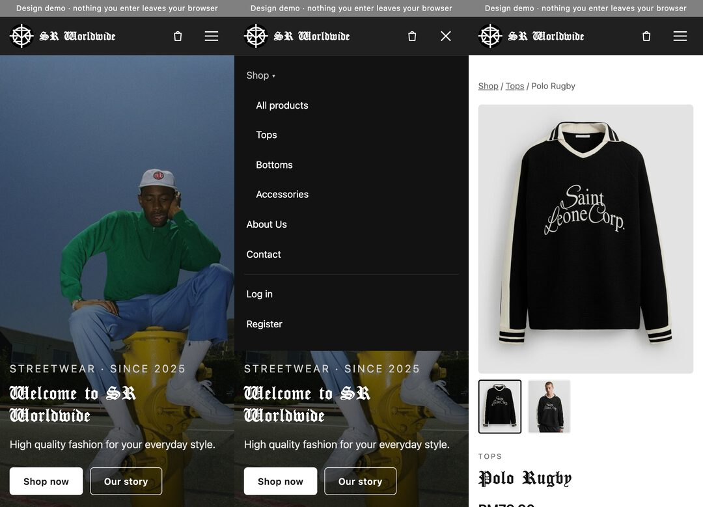

# SR Worldwide

A streetwear e-commerce **website design** (tops, bottoms and accessories) built with plain **HTML, CSS and JavaScript**.
It began as my Semester 1 group project at TVETMARA Lumut (2025) and was redesigned in 2026 as a modern,
mobile-first portfolio piece.

**🔗 Live demo: https://shahredza.github.io/sr-worldwide/**



> **Design demo.** There's no server or database. Products come from a JavaScript file, and the cart,
> demo account, orders and messages are saved only in your own browser (localStorage). Nothing you type is sent anywhere.
>
> The full **PHP + MySQL** version (real database, sessions, CSRF protection, image uploads) is on the
> [`php-mysql-version`](https://github.com/shahredza/sr-worldwide/tree/php-mysql-version) branch.

## What you can try

**Shop**
- Home page with hero, shop-by-category tiles, featured products and the brand mission ("What Drives Us")
- Category pages (Tops, Bottoms, Accessories) with sorting by newest or price
- Product pages with front/back image gallery, size picker and quantity
- Cart: update quantities, remove items, live total, badge in the header
- Checkout with the original delivery fields (full name, nickname, street, city, state, postcode) and form validation
- About Us, Contact and Privacy Policy pages

**Customer account (demo)**
- Register with email, password and birthday (same password rule as the original: 8+ characters with upper case, lower case and a number)
- Log in / log out, and a **My orders** page. Passwords are never stored.

**Admin screens** at [`/admin/`](https://shahredza.github.io/sr-worldwide/admin/login.html), log in with **`admin` / `admin123`** (demo only)
- Dashboard with revenue, orders, pending orders, products and customers
- Products list and add/edit form with image upload validation (type and size)
- Orders: filter by status, view items, change status
- Users and contact messages (mark read/unread, delete)
- Admin screens show sample data **plus** any orders and messages you create in the shop, so you can follow an order from checkout to "shipped".

## Screenshots

| Shop | Product |
| --- | --- |
|  |  |
| **Cart** | **Checkout** |
|  |  |
| **Admin dashboard** | **Admin products** |
|  |  |

**Admin orders**



**Mobile** (home, menu, product)



## Tech

- HTML5, CSS3 (custom, mobile-first, no CSS framework), vanilla JavaScript (no jQuery, no build step)
- Hosted on GitHub Pages
- Accessible basics: semantic HTML, keyboard-friendly menu, focus styles, skip link, `prefers-reduced-motion`
- All text inserted by JavaScript is escaped to avoid HTML injection

## Run it on your computer

No install needed: it's just files. Any static web server works, for example:

```bash
git clone https://github.com/shahredza/sr-worldwide.git
cd sr-worldwide
python3 -m http.server 8000
```

Then open **http://localhost:8000**. (Opening `index.html` directly also works for most pages.)

To reset the demo, clear this site's data in your browser (or run `localStorage.clear()` in the console).

## Project structure

```
index.html  shop.html  product.html  cart.html  checkout.html  account.html
login.html  register.html  about.html  contact.html  privacy.html  404.html
admin/              Admin screens: login, dashboard, products, product form, orders, users, messages
assets/
  css/              style.css (site), admin.css (admin)
  js/               data.js (products + sample data), app.js (site), admin.js (admin)
  images/           Logo, hero, cursor, about photos, social icons
  products/         Product photos
  fonts/            Gothic display font
legacy/             Original 2025 files, kept for reference
docs/screenshots/   Images used in this README
```

## Project history

| | 2025: Semester 1 version | 2026: Redesign |
| --- | --- | --- |
| Pages | ~30 separate HTML/PHP files, one per product | Reusable templates driven by one product data file |
| Design | Desktop-first, inline CSS on every page, jQuery date picker, autoplay music | One mobile-first stylesheet, vanilla JS, no autoplay |
| Shop | "Buy now" form, address only | Cart, checkout, order history, admin order status |
| Admin | Login + public "Register Admin" page | Dashboard, products, orders, users, messages; no public admin sign-up |

The original files are in [`legacy/`](legacy/) for comparison.

## Credits

- **Muhammad Shah Redza**: design and development
- Built as a Semester 1 project for *DFD10033 Big Data Programming Fundamental*, Diploma in Computer Technology (Big Data),
  **TVETMARA Lumut** (IKM Lumut / MARA), January–June 2025. Redesigned 2026.
- Gothic display font and product photos come from the original 2025 student project.
- This is a portfolio/demo shop: no real products are sold and no payments are taken.
